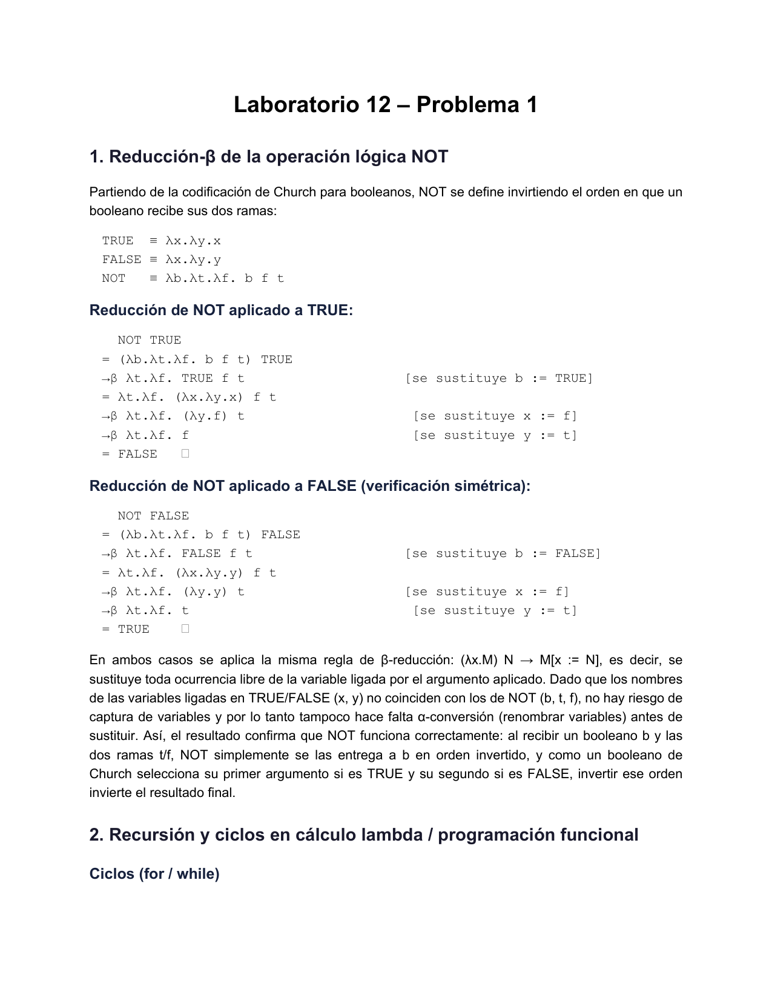
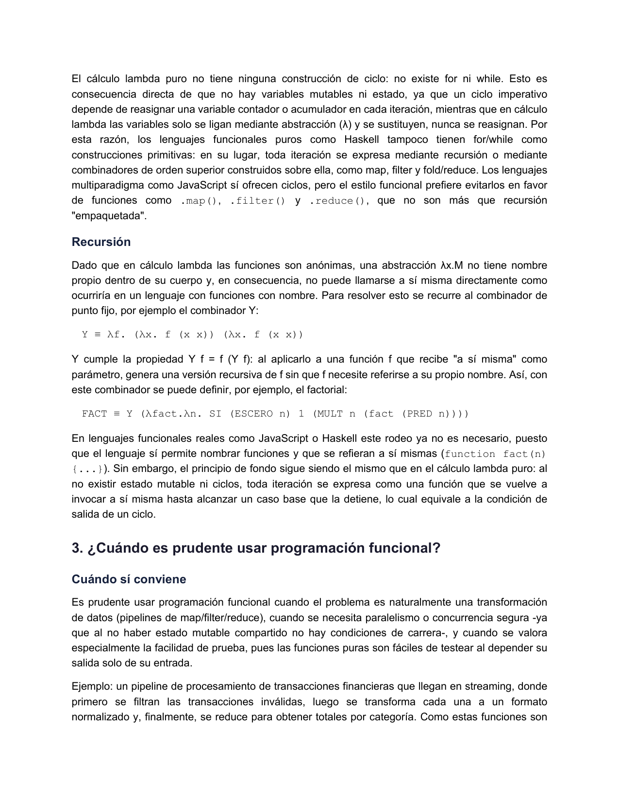
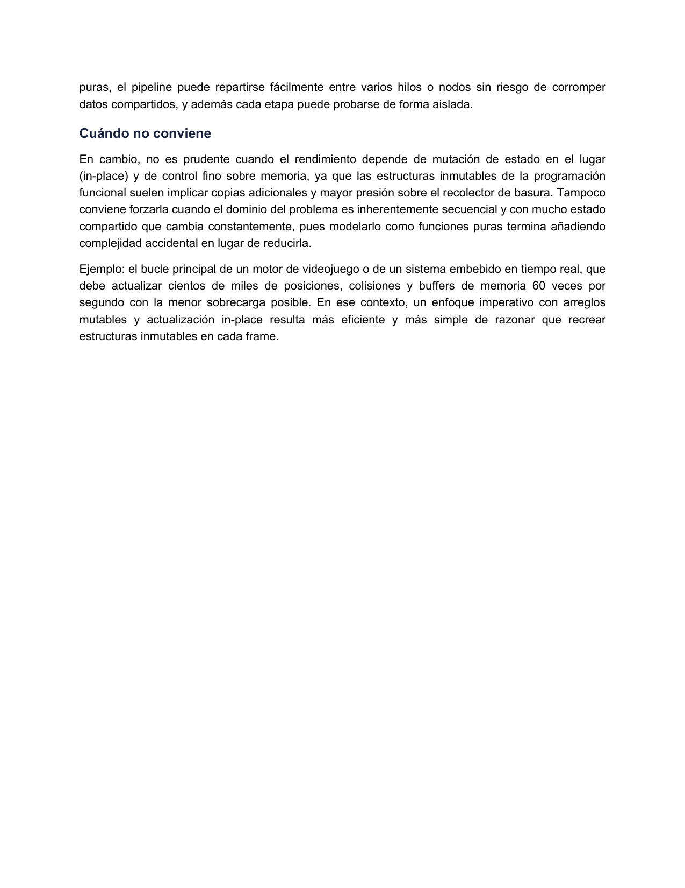

# Laboratorio 12 - Teoría de la Computación

[Video de ejecución](https://youtu.be/dVz1yel4iPk)

## Problema 1

[📄 Ver respuestas.pdf](problema1/respuestas.pdf)





## Lenguaje utilizado

Todos los programas están escritos en **JavaScript (Node.js)**. Las "funciones lambda" que pide el
enunciado (equivalentes a las `lambda` de Python) se implementan con **arrow functions** de
JavaScript (`(args) => expresión`).

Requisitos: [Node.js](https://nodejs.org/) (probado con v24).

## Estructura del repositorio

```
.
├── problema1/
│   └── respuestas.pdf       # Reducción-β de NOT, recursión/ciclos, cuándo usar prog. funcional
├── problema2/
│   └── ordenar_lista.js     # Ordenar lista de diccionarios por key, con arrow functions
├── problema3/
│   └── transpuesta.js       # Transpuesta de una matriz (lista de listas), con arrow functions
├── problema4/
│   └── eliminar_elementos.js # Eliminar elementos de una lista, con arrow functions
└── README.md
```

## Cómo ejecutar cada programa

```bash
node problema2/ordenar_lista.js
node problema3/transpuesta.js
node problema4/eliminar_elementos.js
```

Cada script imprime en consola los datos de entrada del ejemplo del enunciado y el resultado
producido, para poder comparar directamente contra la salida esperada.
